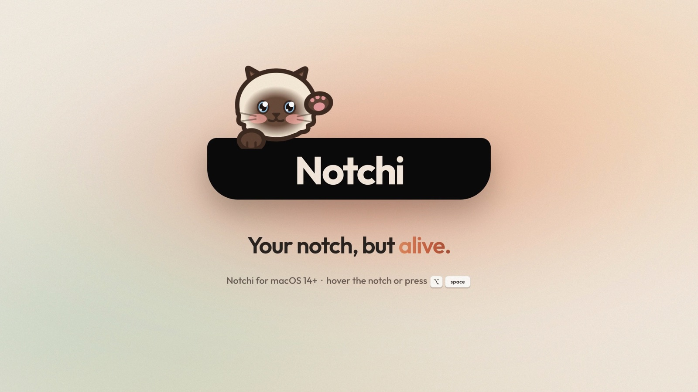

<p align="center">
  
</p>

<h1 align="center">Notchi 🐾</h1>

<p align="center">
  A Dynamic Island for your MacBook's notch, with a little pet that lives next to it.
</p>

<p align="center">
  <a href="https://github.com/JustSid26/notchi/releases/latest/download/Notchi.dmg">
    
  </a>
</p>

<p align="center">
  <sub>macOS 14 or later · Apple Silicon and Intel · free and open source</sub>
</p>

---

A Siamese cat wanders beside your notch. It sits, stretches, dozes, waves when it sees your cursor, swats at it, and bobs its head to your music. **Hover over it** and it jumps into the notch. The island opens, and the cat peeks over the edge at you.

## What's in the island

- **Now Playing:** Spotify and Apple Music with artwork, a scrubber you can click to seek, and play/pause/skip.
- **Live:** a scrollable queue of builds, deploys, timers, Claude Code runs, charging status and anything you push from the terminal. Whatever needs you comes first.
- **Pinned apps:** click to launch, or press **⌘1 to ⌘9** while the island is open. Drag apps in, or press **+**.
- **Ask Claude:** answers stream right in the notch, using your Anthropic API key or your local Claude Code install.
- **Terminal tabs:** pin up to 10 iTerm2 tabs, with their real names and colours, and watch what Claude Code is doing in each one.

## Make it yours

- **Pets:** a cat (Siamese, Ginger, Cream, Midnight, Smoky), a dog (Shiba, Golden, Choco) or a bird (Budgie, Cockatiel, Bluebird), in any size.
- **Position:** in the notch at the top, or on the **left edge** of the screen, where the island turns tall and narrow and your pet climbs the wall.
- **Themes:** Graphite, Midnight, Ocean, Forest, Lavender, Rose or Claude.
- **Surface:** Solid, Frosted or **Liquid Glass** (macOS 26), with adjustable transparency and background blur.

## Shortcuts

| | |
|---|---|
| Open or close the island | hover the pet or the notch, tap **⌘⌥** (press and release together), or **⌥Space** |
| Switch terminal tabs | **⌘↑** / **⌘↓** |
| Launch a pinned app | **⌘1 to ⌘9** |
| Close | move away, click outside, or **Esc** |

The **⌘⌥** tap needs Input Monitoring permission, because macOS only lets apps see a modifier-only shortcut that way. Notchi asks for it the first time. If you'd rather not grant it, **⌥Space** always works (or **⌃⌥Space** if something else has taken it).

## Install

1. [**Download Notchi.dmg**](https://github.com/JustSid26/notchi/releases/latest/download/Notchi.dmg) and drag Notchi into **Applications**.
2. Open it. macOS blocks the first launch, because Notchi isn't notarized (that needs a paid Apple Developer account). Go to **System Settings → Privacy & Security**, scroll down, and click **Open Anyway**.

   Or run this once in Terminal:

   ```bash
   xattr -dr com.apple.quarantine /Applications/Notchi.app
   ```

3. A paw appears in your menu bar. Use it to open the island, change its position, or open Settings.

macOS asks once for each thing Notchi needs:

- control of **Spotify / Music**, for artwork and the playback buttons
- control of **iTerm2**, for terminal tabs
- **Input Monitoring**, only for the ⌘⌥ shortcut

## Terminal tabs + Claude Code

Each pinned tab shows its iTerm2 name and colour, plus what Claude Code is doing there:

- a **spinning ring** with a timer while Claude works
- **!** when it needs your approval (chime + banner)
- **✓** when it finishes (chime + a "Claude finished · 2:14" banner, even with the island closed)

Click a tab, or use **⌘↑ / ⌘↓**, and the prompt bar types into that terminal's Claude session. For safety it won't type into a tab where Claude is waiting for approval, or where Claude isn't running. Drag tabs to reorder them.

Setup, in **Settings → Terminal tabs**:

1. **Install** the `island` command (it links into `~/.local/bin`).
2. **Connect** Claude Code. This adds hooks to `~/.claude/settings.json` and saves a backup as `settings.json.notchi-backup`. New Claude sessions pick them up.
3. Press **+** on the island's Terminals rail and tick the tabs you want. Or, inside a tab, run:

   ```bash
   island tab add            # uses the tab's own title
   island tab add "CRM"      # or give it a name
   island tab remove
   ```

**Tab colours (optional):** turn on iTerm2 → Settings → General → Magic → **Enable Python API**. Then click **Set up** next to *Tab colours* in Notchi's settings.

## Push live activities from anywhere

```bash
island push --id deploy --title "Deploying web" --progress 0.4 --icon arrow.up.circle.fill --tint blue
island push --id deploy --title "Deployed" --state done
island run --title "Tests" -- npm test        # running → ✓ / ✗ with duration
island ask "explain this regex: ^\d{3}-\d{4}$"
```

Under the hood each of these opens a URL, so anything that can open a URL can drive Notchi:
`open -g "notchi://push?id=x&title=Hello&state=attention"`.

## Build from source

You need macOS 14+ and Swift 5.10+. The Xcode command-line tools are enough. Building Liquid Glass needs the macOS 26 SDK.

```bash
./scripts/build-app.sh        # → build/Notchi.app
./scripts/make-dmg.sh         # → build/Notchi.dmg
./scripts/preview-cat.sh      # → build/cat-poses.png + build/cat-demo.gif (renders the pet without launching)
```

`build-app.sh` signs with the first code-signing certificate on your Mac, so macOS remembers Notchi's permissions between builds. If you have none, it falls back to an ad-hoc signature. To create a free certificate: Keychain Access → Certificate Assistant → **Create a Certificate…**, Identity Type *Self Signed Root*, Certificate Type *Code Signing*. Then:

```bash
SIGN_ID="Notchi Self-Signed" ./scripts/build-app.sh
```

### Releases

Pushing a `v*` tag builds a universal DMG on GitHub Actions and attaches it to a GitHub Release. That's the file the **Download for Mac** button points at. To keep the signature stable between releases, export your certificate as a `.p12` file and add two repo secrets: `SIGNING_CERT_P12` (the file, base64-encoded) and `SIGNING_CERT_PASSWORD`.

```bash
git tag v0.2.0 && git push origin v0.2.0
```

## Project layout

```
Sources/Notchi/
  App/        entry point, menu bar item
  Cat/        pet engine (behaviour + physics) and vector renderers for the cat, dog and bird
  Island/     panels, notch geometry, controller (hover, shortcuts, peeks), SwiftUI views
  Services/   now playing, pinned apps, Claude, terminal tabs, iTerm2 colours, live activities, shortcuts
  Settings/   preferences, themes, settings window
bin/island    CLI (live activities, terminal tabs, Claude Code hooks)
```

## License

MIT
